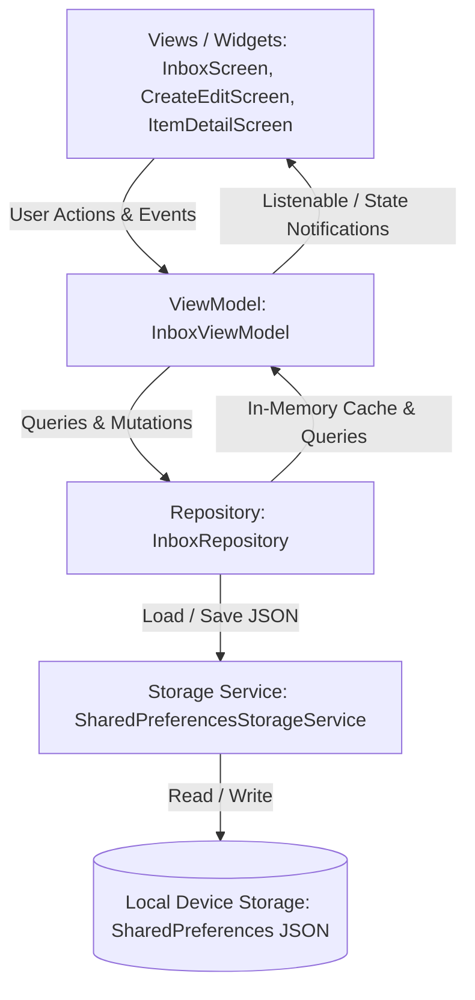

# ByteInbox — Detailed System Functioning & Architecture 📖

This document provides a comprehensive technical walkthrough of how the **ByteInbox** application works, from its local data persistence layer to state management and user interface interactions.

---

## 1. Architectural Blueprint

ByteInbox is engineered with a strict **Separation of Concerns** using the **Layered MVVM (Model-View-ViewModel)** and **Repository** patterns:



### Architectural Responsibilities:
1. **Domain Layer (`lib/domain/`)**: Pure Dart models containing business entities, validation rules, type definitions, and serialization contracts. Zero Flutter UI dependencies.
2. **Data Layer (`lib/data/`)**: Manages offline data storage, file reading/writing, and coordinates in-memory caching.
3. **State Management (`lib/ui/view_models/`)**: Exposes observable state (`ChangeNotifier`) to the views. Handles reactive filtering, search queries, sort orders, and item modifications.
4. **UI Layer (`lib/ui/features/` & `lib/ui/core/`)**: Lean Flutter widgets rendering UI, capturing gestures, and delegating user intent to the ViewModel.

---

## 2. Core Data Model (`InboxItem`)

Every item stored in the application is represented by the immutable `InboxItem` entity:

```dart
class InboxItem {
  final String id;              // UUID v4 unique identifier
  final InboxItemType type;      // note | link | image
  final String title;            // Item headline or auto-generated title
  final String content;          // Note body, web URL, or image file path / URL
  final List<String> tags;       // List of sanitized tag strings (e.g. ['flutter', 'code'])
  final DateTime createdAt;      // ISO-8601 creation timestamp
  final DateTime updatedAt;      // ISO-8601 last modified timestamp
  final bool isArchived;         // Active (false) or Archived (true)
}
```

### Supported Types (`InboxItemType`):
- `InboxItemType.note`: Standard text note. Can contain single thoughts, code snippets, or multi-line paragraphs.
- `InboxItemType.link`: Web URL / bookmark. Stores the website address and enables direct browser launching.
- `InboxItemType.image`: Visual item. Stores a local image file path or network image URL, supporting interactive zoom and aspect ratio rendering.

---

## 3. Local Persistence & Surviving App Restarts

### Why `SharedPreferences` with Structured JSON?
The requirement specifies:
> *"Persist data locally so it survives closing and reopening the app. Use an appropriate option such as SQLite, Room, Core Data, AsyncStorage, Hive, or SharedPreferences."*

`SharedPreferences` was selected because:
1. **Multi-Platform Zero Native Friction**: Works natively on Windows, macOS, Linux, Android, iOS, and Web without requiring platform-specific C/C++ dynamic libraries or compilation toolchains.
2. **Speed & Reliability**: For single-device inboxes containing personal collections (hundreds to thousands of entries), loading a serialized JSON array into memory on startup provides sub-millisecond query responses and zero SQL setup overhead.
3. **Atomic Synchronization**: Any mutation (`addItem`, `updateItem`, `deleteItem`, `toggleArchive`) immediately serializes the current state and writes to persistent device storage.

### Resilient Deserialization:
In `SharedPreferencesStorageService`:
- If the stored string is empty or uninitialized, it returns an empty list.
- If individual records contain unexpected or corrupted fields, they are caught gracefully without failing the entire dataset.
- On first launch when storage is empty, the repository seeds 3 curated starter items (1 note, 1 link, 1 image) so the user can immediately interact with the app.

---

## 4. Repository & In-Memory Query Engine

The `InboxRepository` acts as the single source of truth:

### Querying, Filtering, and Searching:
Instead of requiring repeated asynchronous database queries for every keypress in the search bar, `InboxRepository.query()` executes filtering and sorting against the in-memory cache:

```dart
List<InboxItem> query({
  required bool showArchived,
  ItemTypeFilter typeFilter = ItemTypeFilter.all,
  String? tagFilter,
  String searchQuery = '',
  SortOption sortOption = SortOption.newestFirst,
})
```

1. **Archive Segregation**: If `showArchived == false`, only active items are returned. If `true`, only archived items are returned.
2. **Type Filtering**: Filters down to only notes, only links, or only images when selected.
3. **Tag Filtering**: Matches items containing the selected tag (case-insensitive).
4. **Search Query**: Evaluates whether the trimmed query text appears in:
   - The item's `title`
   - The item's `content`
   - Any of the item's `tags`
5. **Sorting Criteria**:
   - `SortOption.newestFirst`: Sorts descending by `createdAt`.
   - `SortOption.oldestFirst`: Sorts ascending by `createdAt`.
   - `SortOption.recentlyUpdated`: Sorts descending by `updatedAt`.
   - `SortOption.alphabetical`: Case-insensitive A-Z sorting by `title`.

---

## 5. User Flows & Screen Functioning

### Screen 1: Inbox / Home Screen (`InboxScreen`)
- **AppBar**:
  - Displays the active count or archived count in real time.
  - **Sort Menu Button**: Opens popup menu with 4 sorting options.
  - **Inbox/Archive Switcher**: One tap toggles between the active Inbox and the Archived Items view.
- **Search Bar**:
  - Real-time search with an instant clear button (`X`).
  - Search queries update the list dynamically on every keystroke.
- **Type Filter Bar**:
  - Horizontal filter chips: `[All Items]`, `[Notes]`, `[Links]`, `[Images]`.
- **Tag Filter Bar**:
  - Scrollable horizontal row of all unique tags present across stored items.
  - Tapping a tag isolates all items bearing that tag.
- **Item Cards (`ItemCard`)**:
  - Shows item type badge (amber for notes, blue for links, teal for images) and formatted timestamp.
  - **Note Preview**: Multi-line readable snippet.
  - **Link Preview**: Domain badge, full URL preview, and a direct "Open in Browser" button.
  - **Image Preview**: Rounded image thumbnail with loading indicator and broken-image fallback.
  - **Quick Actions Menu**: 
    - "View Details"
    - "Edit"
    - "Archive" / "Restore" (with instant snackbar and **Undo** action)
    - "Delete" (with confirmation dialog)
- **Floating Action Button**:
  - Tap opens a bottom sheet offering direct creation for a Note, a Link, or an Image.

### Screen 2: Create & Edit Screen (`CreateEditScreen`)
- **Segmented Type Selector**:
  - Easily toggle between `Note`, `Link`, and `Image` modes.
- **Adaptive Input Fields**:
  - **Title Field**: Optional. If left blank, the system automatically derives a title upon saving.
  - **For Notes**: Multi-line expandable text area.
  - **For Links**: URL input with a 1-tap "Paste from Clipboard" button, URL syntax validator, and automatic `https://` prefixing.
  - **For Images**:
    - "Pick Image from Device" button (native file picker).
    - Image URL or file path input.
    - Live image preview with real-time feedback.
    - Quick-test preset buttons (e.g. Landscape, Workspace).
- **Tag Manager**:
  - Input field to type a tag and press Enter or `+`.
  - Tags are presented as deletable chips with `(x)`.
  - Shows existing tags as 1-tap chips to avoid re-typing frequently used tags.
- **Validation**:
  - Prevents saving completely empty content.
  - Flags invalid URL formats with helpful error text.

### Screen 3: Item Detail Screen (`ItemDetailScreen`)
- **Header**: Item type badge, archive status pill, formatted creation date.
- **Title**: Selectable large headline.
- **Content Viewer**:
  - **Notes**: Selectable text with a 1-tap "Copy Note" button.
  - **Links**: Prominent card displaying the domain, full URL, a primary "Open in Browser" button (using `url_launcher`), and a "Copy Link" button.
  - **Images**: Interactive viewer with pinch-to-zoom (`InteractiveViewer`), image file path/URL display, and copy button.
- **Tags**: Clickable chips that allow the user to jump back into the inbox pre-filtered by that tag.
- **Metadata Inspection**: Created timestamp, last updated timestamp, and internal unique ID.
- **Action Buttons in AppBar**:
  - Edit: Opens the item in `CreateEditScreen`.
  - Archive/Restore: Changes archive status.
  - Delete: Prompts for confirmation before permanent deletion.

---

## 6. Input Handling & Edge Case Resilience

| Scenario | Application Behavior |
| :--- | :--- |
| **User leaves Title blank** | The app automatically generates a contextual title: <br>• **Note**: Uses the first line of content up to 50 characters.<br>• **Link**: Extracts the website domain and URL path (e.g. `flutter.dev / docs`).<br>• **Image**: Extracts the filename from the path or URL. |
| **User enters URL without protocol** (e.g. `github.com`) | `AppUtils.normalizeUrl()` automatically detects missing scheme and prepends `https://`. |
| **Malformed or invalid URL** | The form validation catches invalid URIs and alerts the user before saving. |
| **Tags with `#`, extra spaces, or duplicate casing** | `InboxItem.cleanTags()` trims spaces, strips leading `#`, removes blank entries, and performs case-insensitive deduplication (e.g. `[' #Flutter', 'flutter ', '']` → `['flutter']`). |
| **Image file deleted or network URL unreachable** | `ItemCard` and `ItemDetailScreen` render a clean fallback placeholder with a broken-image icon and clear user message instead of throwing an unhandled exception. |
| **User closes and reopens the app** | All items, edits, tags, and archive states are reloaded from `SharedPreferences` with exact state preservation. |

---

## 7. Testing Strategy

The test suite covers every layer of the application:

```
test/
├── domain/models/inbox_item_test.dart        # 8 unit tests: model creation, tag sanitization, fallback titles, serialization, copyWith
├── data/repositories/inbox_repository_test.dart # 12 unit tests: CRUD, archiving, multi-field search, filters, relaunch simulation
├── ui/inbox_view_model_test.dart            # 6 unit tests: state management, reactive filters, listener notifications
└── widget_test.dart                         # 6 widget tests: UI smoke test, search filtering, archive flow, creation form
```

### Relaunch Simulation Test (`inbox_repository_test.dart`):
Specifically simulates app termination:
1. Adds active notes and archived links to storage in Session 1.
2. Discards the in-memory repository.
3. Instantiates a new repository in Session 2 reading from storage.
4. Asserts that 100% of the items, titles, tags, and archive states match Session 1.

All **32 tests** pass cleanly with zero analyzer diagnostics.
